# Прогнозирование почасового спроса на велопрокат


Профиль: **full**. Завершенность итогового проекта: **True**.

Статус запуска: All scheduled jobs finished.

Полный протокол использует расширяющиеся обучающие выборки, 4 окна каждого этапа и два горизонта.


## 1. Данные, постановка задачи и EDA


Источник: [UCI Bike Sharing](https://archive.ics.uci.edu/dataset/275/bike+sharing+dataset), DOI 10.24432/C5W894, Hadi Fanaee-T; публикация Hadi Fanaee-T и João Gama. Лицензия CC BY 4.0. Согласование с преподавателем не зафиксировано.

Цель — офлайн-прогноз общего числа аренд cnt для планирования доступности велосипедов. Основной горизонт 24 часа, дополнительный 168 часов. Ряд один: глобальные модели между станциями не требуются.

Период: 2011-01-01 00:00:00 — 2012-12-31 23:00:00. Наблюдений: **17379**; часов в регулярной сетке: **17544**; отсутствующих часов: **165**.

Временные метки трактуются как локальные метки источника без искусственного перевода в UTC. Неоднозначности перехода на летнее время нельзя восстановить из исходной таблицы. Пропуски не объявляются нулевыми: обучение использует прошлую неделю/последнее известное значение, оценка — только наблюдаемые цели. casual и registered исключены. Исследовательский EDA ограничен датой 2012-11-01.

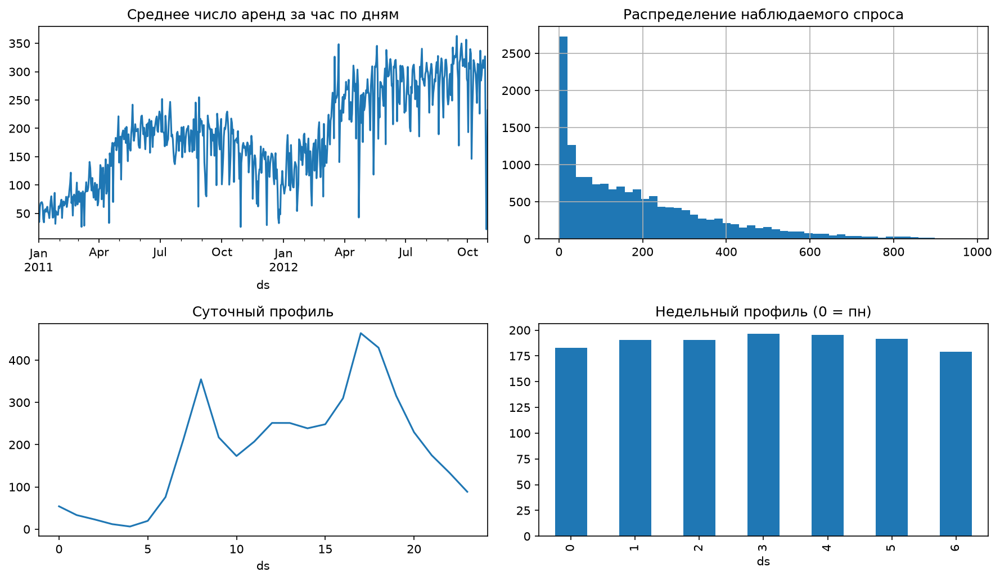

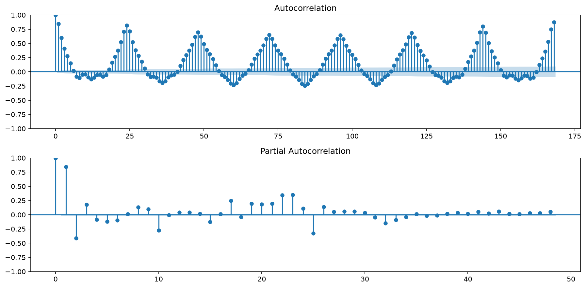

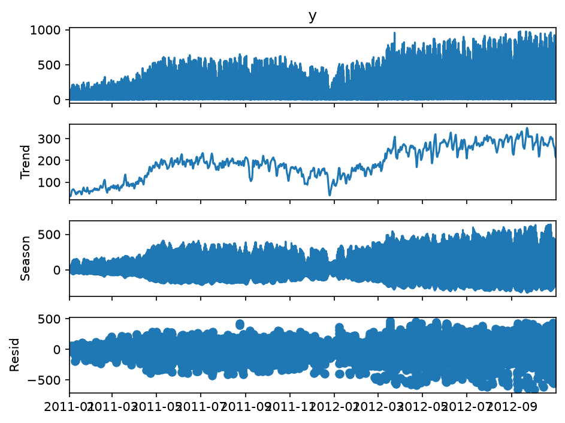

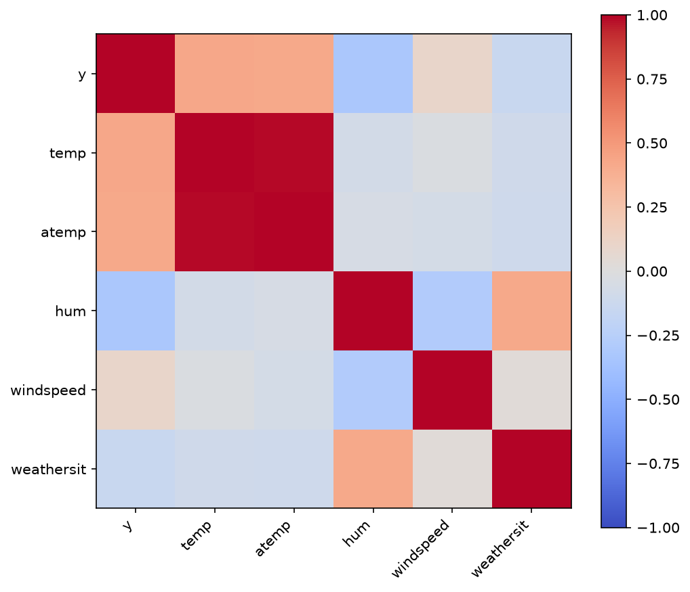

Вывод EDA: по 15919 наблюдениям средний спрос составляет 189.48 аренд/час, стандартное отклонение 182.01, максимум 977. Высокая изменчивость требует сравнения с сезонным бейзлайном.

ADF p-value: исходный ряд 9.353e-13, разность с лагом 24 0. KPSS p-value: 0.01 и 0.1. ADF проверяет нулевую гипотезу единичного корня, KPSS — стационарности; граничные p-value KPSS ограничены таблицей теста. Тесты не заменяют анализ сезонности.


## 2. Статистические модели и оценка надежности


Сравниваются пять семейств ARIMA, ETS, Theta, CES и MSTL, а также SeasonalNaive(168). AutoARIMA и AutoETS показаны дополнительно к ручным вариантам. ARIMA(1,1,1) с сезонной AR(1) задает компактную ручную модель; ETS(AAA) допускает аддитивные тренд и сезонность. Периоды 24/168 соответствуют суткам/неделе. MSTL использует обе сезонности и AutoETS для тренда. Выбор конфигурации — по среднему MAE валидации.

Валидация: 1/15 сентября и 1/15 октября; калибровка: 1/8/15/22 ноября; тест: 1/8/15/22 декабря 2012 года. Предыдущие тестовые наблюдения становятся доступны для переобучения следующих окон, но не для настройки параметров.

MAE и RMSE выражены в арендах/час; WAPE — доля, не проценты. MASE нормируется на обучающую ошибку сезонного наивного прогноза с лагом 168. Сводные показатели — среднее метрик окон, а не метрики искусственно склеенного ряда.


Выбранные на валидации параметры:


```json

{
  "24": {
    "SeasonalNaive": {
      "season_length": 168
    },
    "ARIMA": {
      "season_length": 168,
      "order": [
        1,
        1,
        1
      ],
      "seasonal_order": [
        1,
        0,
        0
      ]
    },
    "AutoARIMA": {
      "season_length": 168,
      "max_p": 2,
      "max_q": 2,
      "max_P": 1,
      "max_Q": 1,
      "max_order": 4,
      "nmodels": 20,
      "stepwise": true,
      "approximation": true
    },
    "ETS": {
      "season_length": 168,
      "model": "AAA"
    },
    "AutoETS": {
      "season_length": 168,
      "model": "ZZZ"
    },
    "Theta": {
      "season_length": 168
    },
    "CES": {
      "season_length": 168
    },
    "MSTL": {
      "season_length": [
        24,
        168
      ]
    },
    "Ridge": {
      "alpha": 100.0
    },
    "RandomForestRegressor": {
      "n_estimators": 200,
      "max_depth": 20,
      "min_samples_leaf": 4
    },
    "HistGradientBoostingRegressor": {
      "max_iter": 250,
      "max_leaf_nodes": 31,
      "learning_rate": 0.05
    },
    "MLP": {
      "input_size": 168
    },
    "LSTM": {
      "input_size": 336
    },
    "NHITS": {
      "input_size": 336
    }
  },
  "168": {
    "SeasonalNaive": {
      "season_length": 168
    },
    "ARIMA": {
      "season_length": 168,
      "order": [
        1,
        1,
        1
      ],
      "seasonal_order": [
        1,
        0,
        0
      ]
    },
    "AutoARIMA": {
      "season_length": 168,
      "max_p": 2,
      "max_q": 2,
      "max_P": 1,
      "max_Q": 1,
      "max_order": 4,
      "nmodels": 20,
      "stepwise": true,
      "approximation": true
    },
    "ETS": {
      "season_length": 168,
      "model": "AAA"
    },
    "AutoETS": {
      "season_length": 168,
      "model": "ZZZ"
    },
    "Theta": {
      "season_length": 168
    },
    "CES": {
      "season_length": 168
    },
    "MSTL": {
      "season_length": [
        24,
        168
      ]
    },
    "Ridge": {
      "alpha": 100.0
    },
    "RandomForestRegressor": {
      "n_estimators": 200,
      "max_depth": 20,
      "min_samples_leaf": 4
    },
    "HistGradientBoostingRegressor": {
      "max_iter": 250,
      "max_leaf_nodes": 31,
      "learning_rate": 0.05
    },
    "MLP": {
      "input_size": 168
    },
    "LSTM": {
      "input_size": 336
    },
    "NHITS": {
      "input_size": 336
    }
  }
}

```


Тестовые результаты (только успешно выполненные модели):


| phase   | group       | model                         |   horizon |    MAE |    RMSE |   WAPE |   MASE |   fit_seconds |   predict_seconds |
|:--------|:------------|:------------------------------|----------:|-------:|--------:|-------:|-------:|--------------:|------------------:|
| test    | DL          | LSTM                          |        24 | 50.234 |  67.461 |  0.500 |  0.994 |         4.286 |             0.015 |
| test    | DL          | LSTM                          |       168 | 61.703 |  89.274 |  0.639 |  1.222 |         3.134 |             0.016 |
| test    | DL          | MLP                           |        24 | 46.589 |  59.388 |  0.450 |  0.922 |         3.770 |             0.018 |
| test    | DL          | MLP                           |       168 | 69.952 | 100.385 |  0.649 |  1.384 |         3.710 |             0.016 |
| test    | DL          | NHITS                         |        24 | 38.990 |  51.221 |  0.353 |  0.772 |         6.023 |             0.019 |
| test    | DL          | NHITS                         |       168 | 63.717 |  95.814 |  0.554 |  1.261 |         5.468 |             0.019 |
| test    | ML          | HistGradientBoostingRegressor |        24 | 54.827 |  72.815 |  0.509 |  1.085 |         0.306 |             0.054 |
| test    | ML          | HistGradientBoostingRegressor |       168 | 59.961 |  85.923 |  0.611 |  1.187 |         0.286 |             0.339 |
| test    | ML          | RandomForestRegressor         |        24 | 54.738 |  77.628 |  0.522 |  1.083 |         2.999 |             0.548 |
| test    | ML          | RandomForestRegressor         |       168 | 63.503 |  92.123 |  0.652 |  1.257 |         2.999 |             3.709 |
| test    | ML          | Ridge                         |        24 | 73.318 |  95.881 |  0.584 |  1.450 |         0.033 |             0.033 |
| test    | ML          | Ridge                         |       168 | 74.024 | 106.118 |  0.670 |  1.465 |         0.032 |             0.187 |
| test    | baseline    | SeasonalNaive                 |        24 | 78.917 | 100.418 |  0.677 |  1.562 |         0.002 |             0.001 |
| test    | baseline    | SeasonalNaive                 |       168 | 68.226 | 103.457 |  0.649 |  1.351 |         0.002 |             0.003 |
| test    | statistical | ARIMA                         |        24 | 56.438 |  73.691 |  0.383 |  1.117 |         7.126 |             0.005 |
| test    | statistical | ARIMA                         |       168 | 55.345 |  80.756 |  0.438 |  1.095 |         7.234 |             0.028 |
| test    | statistical | AutoARIMA                     |        24 | 76.734 |  99.637 |  0.653 |  1.519 |       237.655 |             0.005 |
| test    | statistical | AutoARIMA                     |       168 | 68.326 | 103.722 |  0.650 |  1.352 |       236.061 |             0.028 |
| test    | statistical | AutoETS                       |        24 | 50.324 |  65.525 |  0.507 |  0.996 |       151.251 |             0.001 |
| test    | statistical | AutoETS                       |       168 | 60.267 |  89.869 |  0.588 |  1.193 |       172.014 |             0.003 |
| test    | statistical | CES                           |        24 | 78.737 | 103.284 |  0.739 |  1.559 |         2.384 |             0.001 |
| test    | statistical | CES                           |       168 | 86.347 | 118.897 |  0.885 |  1.709 |         2.326 |             0.003 |
| test    | statistical | ETS                           |        24 | 56.566 |  72.942 |  0.570 |  1.120 |         7.526 |             0.001 |
| test    | statistical | ETS                           |       168 | 64.923 |  96.471 |  0.647 |  1.285 |         7.479 |             0.003 |
| test    | statistical | MSTL                          |        24 | 42.076 |  58.764 |  0.402 |  0.833 |         3.313 |             0.002 |
| test    | statistical | MSTL                          |       168 | 54.446 |  84.715 |  0.501 |  1.078 |         3.298 |             0.003 |
| test    | statistical | Theta                         |        24 | 22.697 |  34.284 |  0.128 |  0.449 |         7.425 |             0.002 |
| test    | statistical | Theta                         |       168 | 38.989 |  61.275 |  0.278 |  0.771 |         7.306 |             0.003 |


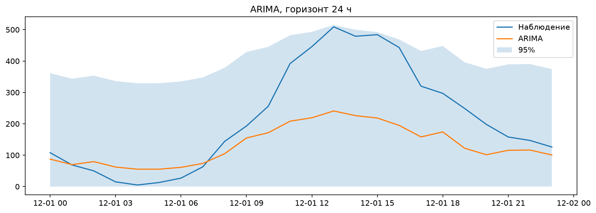


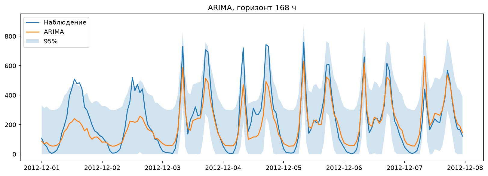


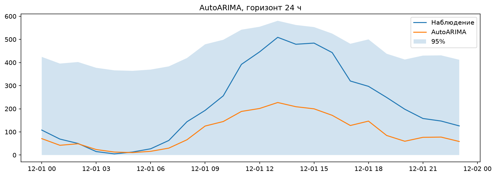


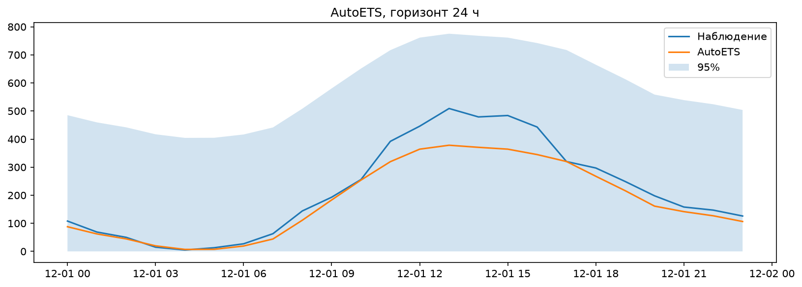


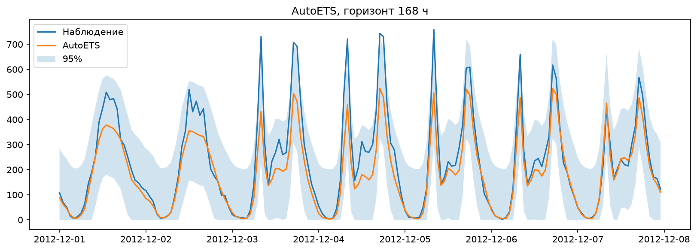


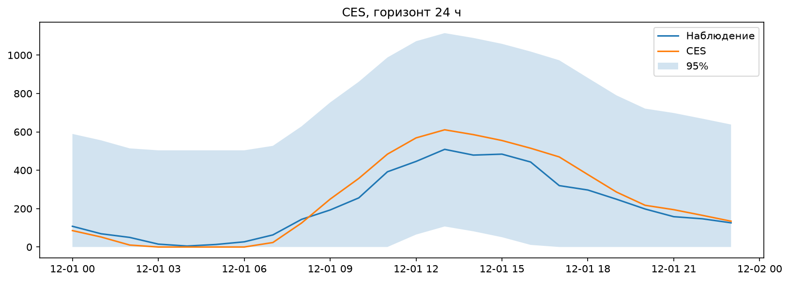


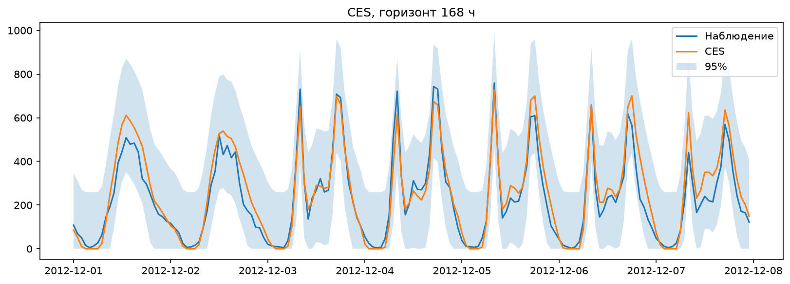


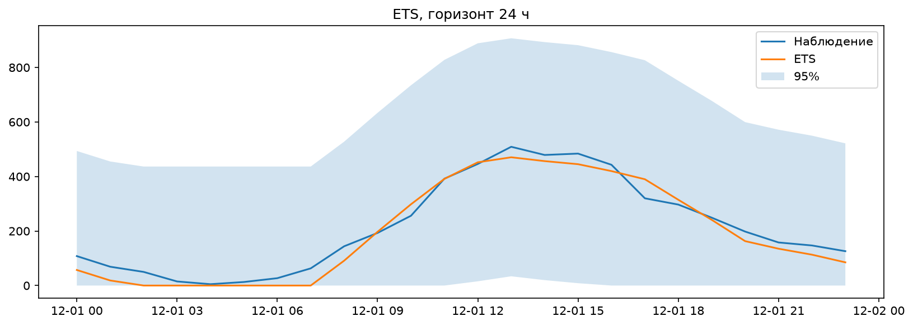


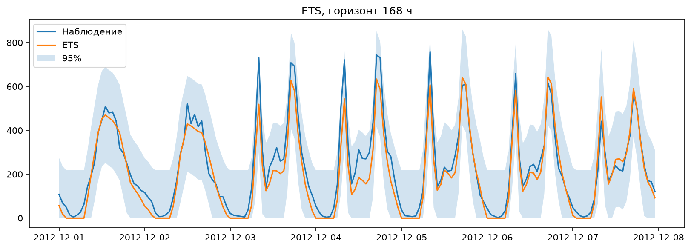


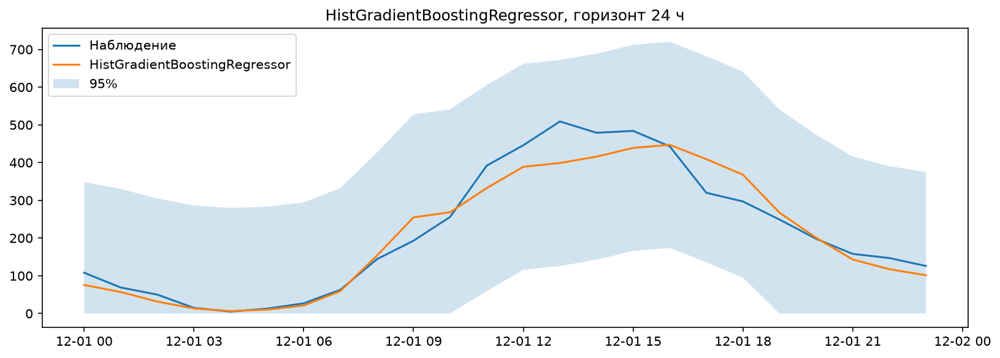


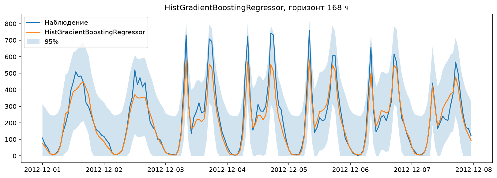


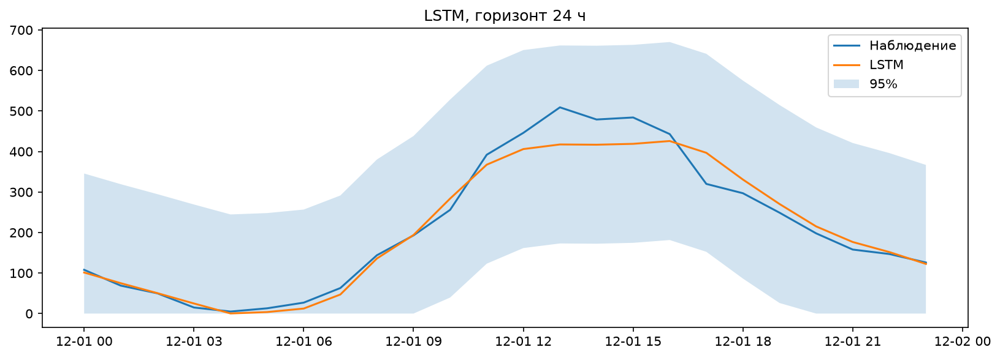


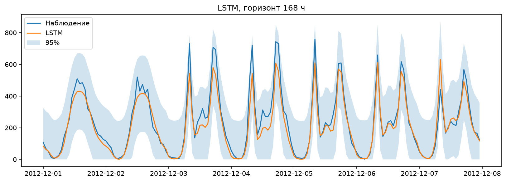


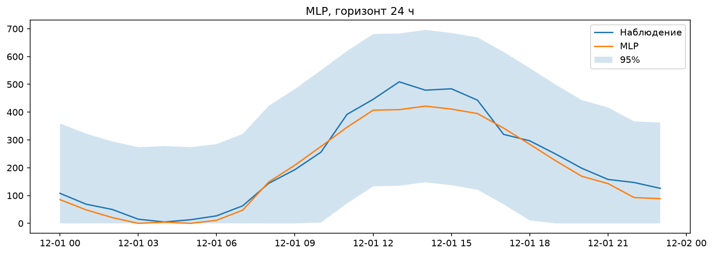


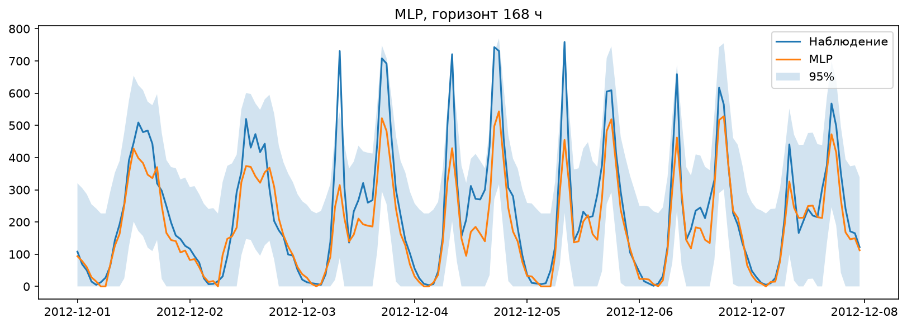


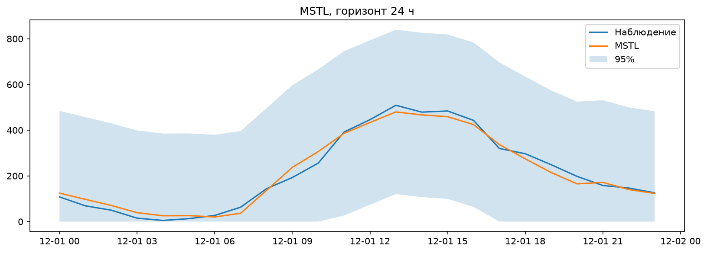


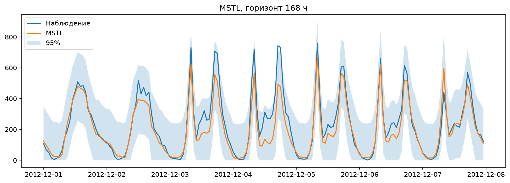


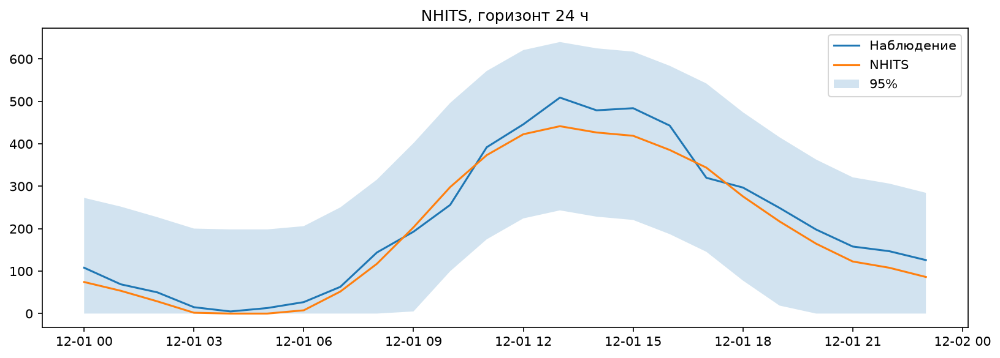


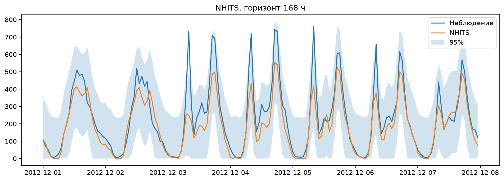


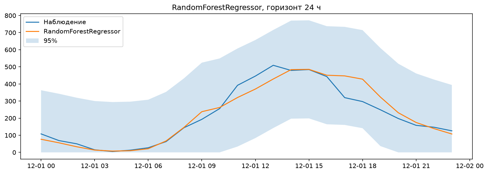


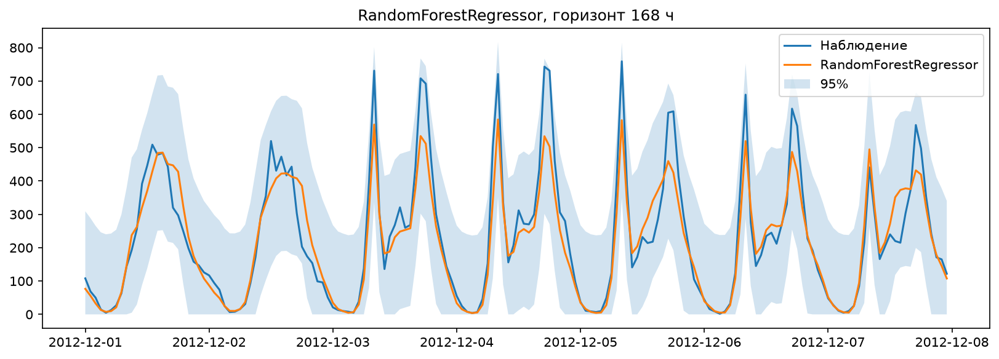


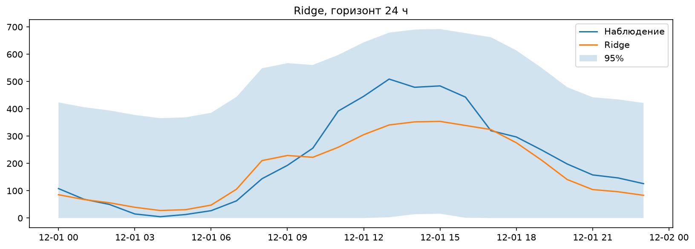


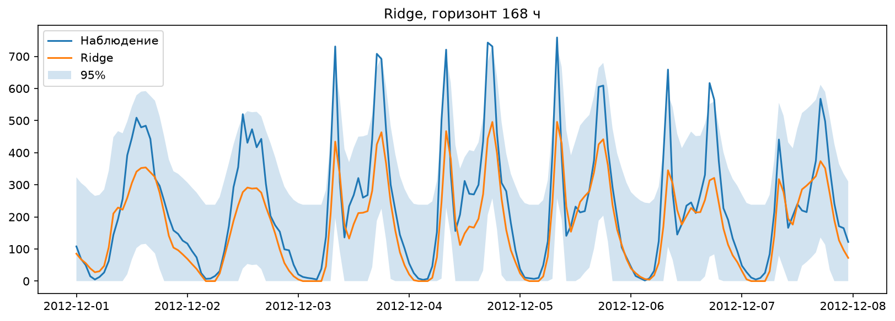


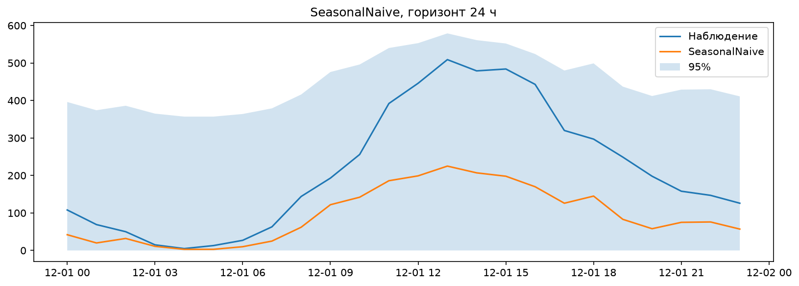


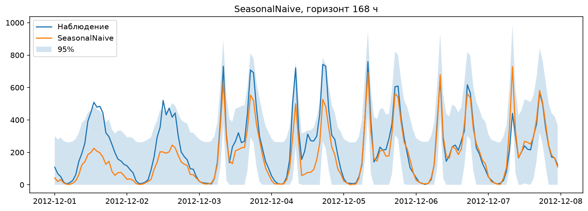


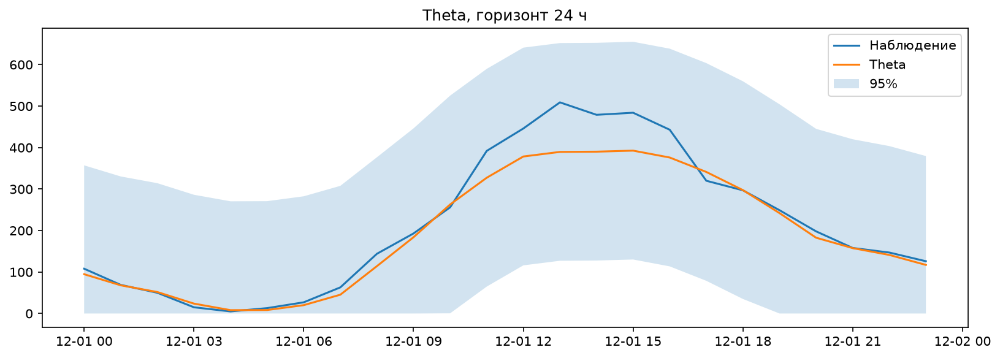


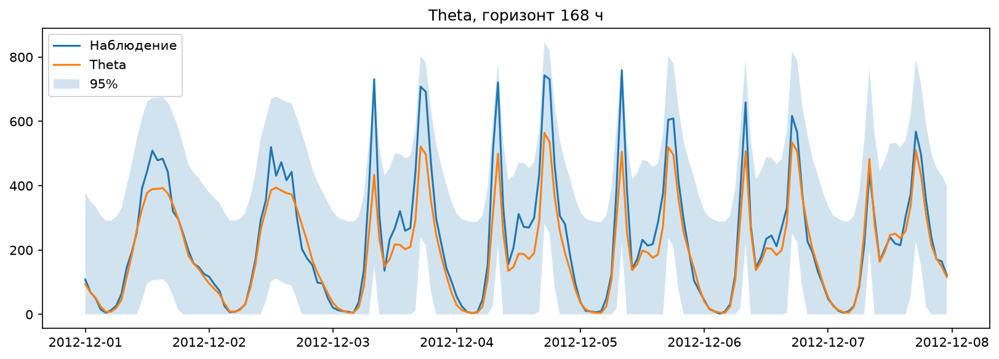


Покрытие и средняя ширина интервалов:


|                                              |   coverage |   mean_width |
|:---------------------------------------------|-----------:|-------------:|
| ('ARIMA', 24, 0.8)                           |      0.802 |      167.201 |
| ('ARIMA', 24, 0.95)                          |      1.000 |      423.385 |
| ('ARIMA', 168, 0.8)                          |      0.900 |      221.472 |
| ('ARIMA', 168, 0.95)                         |      0.973 |      390.349 |
| ('AutoARIMA', 24, 0.8)                       |      0.729 |      174.981 |
| ('AutoARIMA', 24, 0.95)                      |      1.000 |      521.726 |
| ('AutoARIMA', 168, 0.8)                      |      0.831 |      232.994 |
| ('AutoARIMA', 168, 0.95)                     |      0.947 |      417.603 |
| ('AutoETS', 24, 0.8)                         |      0.812 |      169.069 |
| ('AutoETS', 24, 0.95)                        |      1.000 |      596.536 |
| ('AutoETS', 168, 0.8)                        |      0.765 |      151.754 |
| ('AutoETS', 168, 0.95)                       |      0.928 |      334.582 |
| ('CES', 24, 0.8)                             |      0.844 |      227.641 |
| ('CES', 24, 0.95)                            |      1.000 |      738.993 |
| ('CES', 168, 0.8)                            |      0.775 |      220.647 |
| ('CES', 168, 0.95)                           |      0.914 |      431.356 |
| ('ETS', 24, 0.8)                             |      0.865 |      161.042 |
| ('ETS', 24, 0.95)                            |      1.000 |      645.623 |
| ('ETS', 168, 0.8)                            |      0.786 |      152.210 |
| ('ETS', 168, 0.95)                           |      0.931 |      356.674 |
| ('HistGradientBoostingRegressor', 24, 0.8)   |      0.740 |      136.555 |
| ('HistGradientBoostingRegressor', 24, 0.95)  |      1.000 |      435.629 |
| ('HistGradientBoostingRegressor', 168, 0.8)  |      0.818 |      187.387 |
| ('HistGradientBoostingRegressor', 168, 0.95) |      0.953 |      391.430 |
| ('LSTM', 24, 0.8)                            |      0.781 |      138.589 |
| ('LSTM', 24, 0.95)                           |      0.958 |      397.582 |
| ('LSTM', 168, 0.8)                           |      0.836 |      206.965 |
| ('LSTM', 168, 0.95)                          |      0.952 |      395.984 |
| ('MLP', 24, 0.8)                             |      0.802 |      128.555 |
| ('MLP', 24, 0.95)                            |      1.000 |      436.986 |
| ('MLP', 168, 0.8)                            |      0.766 |      182.757 |
| ('MLP', 168, 0.95)                           |      0.938 |      376.741 |
| ('MSTL', 24, 0.8)                            |      0.844 |      140.569 |
| ('MSTL', 24, 0.95)                           |      1.000 |      548.536 |
| ('MSTL', 168, 0.8)                           |      0.837 |      171.023 |
| ('MSTL', 168, 0.95)                          |      0.958 |      362.441 |
| ('NHITS', 24, 0.8)                           |      0.812 |      108.038 |
| ('NHITS', 24, 0.95)                          |      1.000 |      325.502 |
| ('NHITS', 168, 0.8)                          |      0.811 |      187.723 |
| ('NHITS', 168, 0.95)                         |      0.962 |      386.344 |
| ('RandomForestRegressor', 24, 0.8)           |      0.781 |      164.230 |
| ('RandomForestRegressor', 24, 0.95)          |      0.990 |      455.977 |
| ('RandomForestRegressor', 168, 0.8)          |      0.803 |      193.633 |
| ('RandomForestRegressor', 168, 0.95)         |      0.952 |      388.385 |
| ('Ridge', 24, 0.8)                           |      0.708 |      167.624 |
| ('Ridge', 24, 0.95)                          |      1.000 |      508.920 |
| ('Ridge', 168, 0.8)                          |      0.802 |      209.166 |
| ('Ridge', 168, 0.95)                         |      0.939 |      385.141 |
| ('SeasonalNaive', 24, 0.8)                   |      0.729 |      172.427 |
| ('SeasonalNaive', 24, 0.95)                  |      1.000 |      521.719 |
| ('SeasonalNaive', 168, 0.8)                  |      0.835 |      233.937 |
| ('SeasonalNaive', 168, 0.95)                 |      0.947 |      413.799 |
| ('Theta', 24, 0.8)                           |      0.990 |      218.721 |
| ('Theta', 24, 0.95)                          |      1.000 |      402.244 |
| ('Theta', 168, 0.8)                          |      0.916 |      201.727 |
| ('Theta', 168, 0.95)                         |      0.999 |      427.637 |


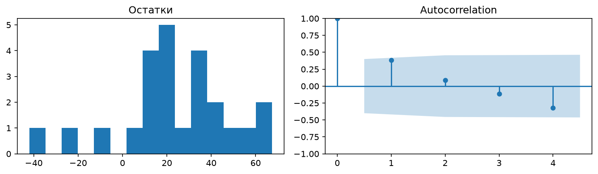


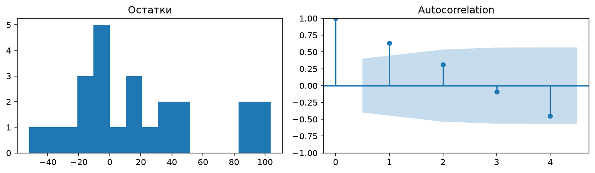


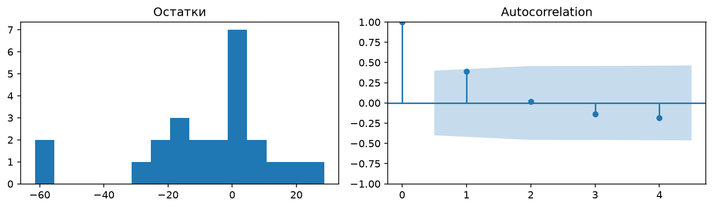


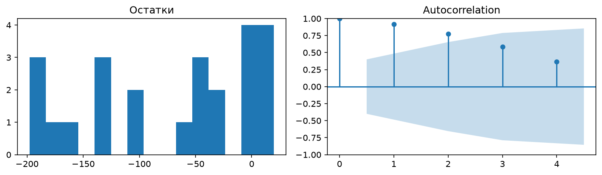


Лидер валидации h=24: **NHITS**. Разность MAE с бейзлайном (лидер − бейзлайн): -39.927; блочный bootstrap 95%: [-76.084; -3.770], блоков 4. Отрицательная разность означает меньшую ошибку лидера.


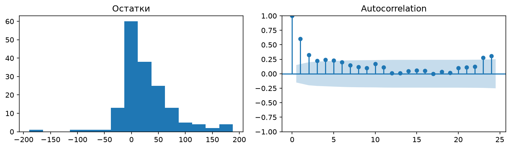


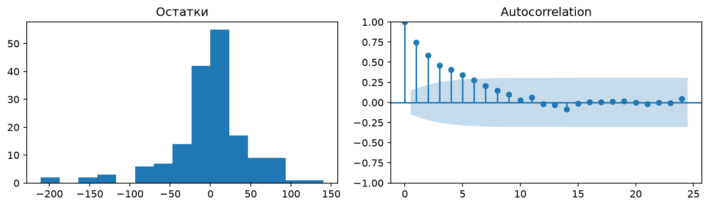


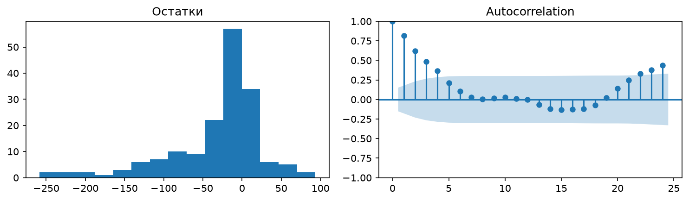


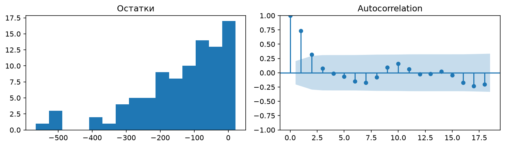


Лидер валидации h=168: **LSTM**. Разность MAE с бейзлайном (лидер − бейзлайн): -6.565; блочный bootstrap 95%: [-17.438; 2.885], блоков 28. Отрицательная разность означает меньшую ошибку лидера.


| model   |   horizon | origin     |   n_contiguous |   lag |   ljung_box_p |
|:--------|----------:|:-----------|---------------:|------:|--------------:|
| NHITS   |        24 | 2012-12-01 |             24 |     4 |     0.09673   |
| NHITS   |        24 | 2012-12-08 |             24 |     4 |     0.0004267 |
| NHITS   |        24 | 2012-12-15 |             24 |     4 |     0.2175    |
| NHITS   |        24 | 2012-12-22 |             24 |     4 |     4.615e-11 |
| LSTM    |       168 | 2012-12-01 |            168 |    24 |     1.018e-24 |
| LSTM    |       168 | 2012-12-08 |            168 |    24 |     1.814e-43 |
| LSTM    |       168 | 2012-12-15 |            168 |    24 |     6.299e-64 |
| LSTM    |       168 | 2012-12-22 |             92 |    18 |     5.824e-11 |


Вывод раздела 2: среди выполненных статистических результатов минимальный тестовый MAE 22.697 у Theta, h=24. Это описательная оценка; выбор для использования делается на валидации.


Интервалы используют ноябрьские абсолютные ошибки, объединенные по шагам отдельно для модели и горизонта. Временная зависимость и изменение спроса нарушают предпосылку обменности: номинальное покрытие не гарантируется. Четыре декабрьских окна дают ограниченную оценку надежности. Ljung–Box здесь — диагностика ошибок многокрокового прогноза, а не доказательство корректности спецификации модели.


## 3. ML, DL и дополнительные эксперименты


ML использует рекурсивный прогноз с лагами 1, 2, 24, 48, 168, 336 и скользящими статистиками за 24/168 часов, сдвинутыми минимум на 1 час. Ridge включает стандартизацию признаков внутри fit. RandomForest и HistGradientBoosting моделируют нелинейные связи. MLP, LSTM и NHITS сравнивают полносвязную, рекуррентную и многомасштабную архитектуры. DL нормирует данные в рамках обучения; ранняя остановка использует последний внутренний holdout, не внешнее окно оценки.

Погодная абляция использует лаг 168 часов для каждого признака: все его значения доступны при выпуске прогноза на обоих горизонтах. Это проверка полезности исторической погоды, а не эксперимент с идеальным прогнозом погоды. log1p оценивается после обратного преобразования; коррекция смещения не применяется. Отрицательные прогнозы всех моделей обрезаются до нуля без округления.


Вывод ML: лучший наблюдаемый тестовый MAE 54.738 у RandomForestRegressor, h=24; сравнение ограничено выполненными конфигурациями.


Вывод DL: лучший наблюдаемый тестовый MAE 38.990 у NHITS, h=24; сравнение ограничено выполненными конфигурациями.


|                                                 |    MAE |   RMSE |   fit_seconds |
|:------------------------------------------------|-------:|-------:|--------------:|
| ('NHITS', 'historical_weather')                 | 71.855 | 95.713 |         5.819 |
| ('NHITS', 'log1p')                              | 51.158 | 81.696 |         5.806 |
| ('NHITS', 'missing_1pct')                       | 49.023 | 74.400 |         5.606 |
| ('NHITS', 'missing_5pct')                       | 44.018 | 66.171 |         5.807 |
| ('NHITS', 'no_calendar')                        | 52.534 | 77.229 |         5.365 |
| ('NHITS', 'seed17')                             | 46.473 | 69.763 |         5.738 |
| ('NHITS', 'seed2026')                           | 43.152 | 67.050 |         5.797 |
| ('RandomForestRegressor', 'historical_weather') | 52.275 | 77.304 |         3.271 |
| ('RandomForestRegressor', 'log1p')              | 61.548 | 91.077 |         2.570 |
| ('RandomForestRegressor', 'missing_1pct')       | 52.510 | 77.200 |         2.592 |
| ('RandomForestRegressor', 'missing_5pct')       | 57.470 | 84.922 |         2.625 |
| ('RandomForestRegressor', 'no_calendar')        | 56.581 | 83.604 |         2.234 |
| ('RandomForestRegressor', 'seed17')             | 51.866 | 76.843 |         2.616 |
| ('RandomForestRegressor', 'seed2026')           | 54.040 | 79.287 |         2.589 |


Сравнение расширений проводится только на валидации; исходные значения приведены в summary.csv (phase=validation).


## 4. Пайплайн и воспроизводимость


Загрузка → регулярная сетка и маска → временные разбиения → подбор параметров → калибровка → тест → отчет. Код запускает эксперименты в отдельных процессах. Кэш учитывает данные, конфигурацию, код и версии окружения. Успешные задания переиспользуются; ошибочные повторяются. Подробности: resolved.yaml, environment.json, hardware.json, records.json, metrics_by_window.csv и predictions.csv.

Вывод раздела 4: записано заданий 488, неуспешных 0, попаданий в кэш 75; время текущего запуска 10053.3 с. Тесты корректности запускаются командой python -m pytest.


## Общее заключение


Исследуется UCI Bike Sharing за 2011–2012 годы: 17379 наблюдаемых часов. Задача — прогноз спроса на 24 и 168 часов с сопоставлением статистических, ML- и DL-моделей.

Для h=24 лидер валидации NHITS: тестовые MAE 38.990, RMSE 51.221, WAPE 0.353. Оценки применимы к указанным временным окнам и профилю запуска.

Для h=168 лидер валидации LSTM: тестовые MAE 61.703, RMSE 89.274, WAPE 0.639. Оценки применимы к указанным временным окнам и профилю запуска.

Полное исследование завершено.